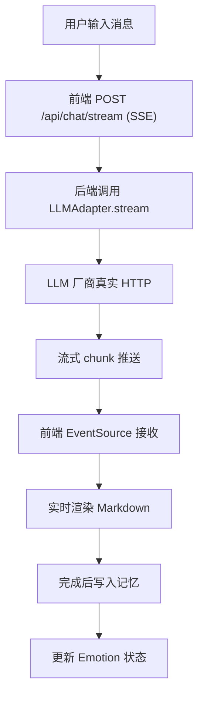
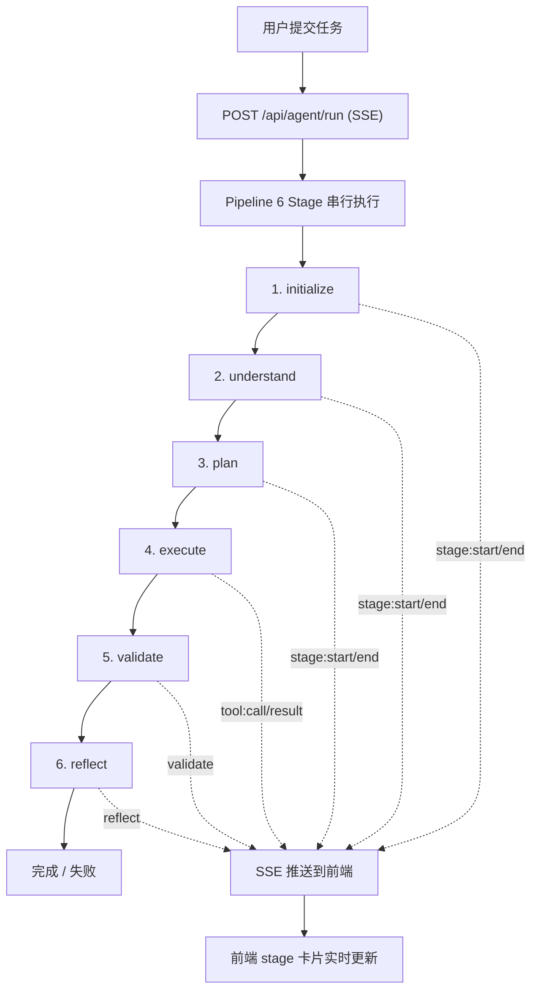
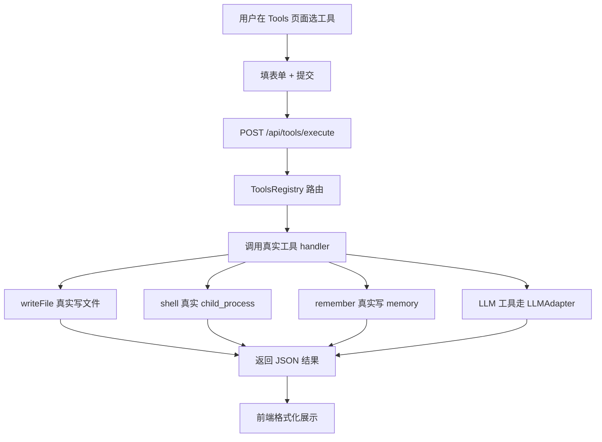

# Personal-Assistant Web — 产品需求文档（PRD）

## 1. 产品概述

Personal-Assistant Web 是 Personal-Assistant CLI 智能体的 **Web 前端**，让用户通过浏览器即可使用 AI 智能体的全部能力：多轮对话、Agent 任务、工具调用可视化、长期记忆管理、LLM Provider 配置。

- 解决 CLI 工具不便于日常使用、无法分享、可视化差的问题
- 目标用户：开发者、技术创作者、AI 重度用户
- 价值：把已经存在的真实 LLM/Agent/Memory/Tools 后端能力以高可用的 Web 形式呈现

## 2. 核心功能

### 2.1 用户角色
不需要登录（本地使用）。所有配置（API key、对话历史、记忆）存到本机后端（Express 持久化到 conf / 文件系统）。

### 2.2 功能模块

1. **对话页面（Chat）** — 多轮对话、流式响应、Markdown 渲染、代码高亮、消息复制
2. **Agent 任务页面（Agent）** — 提交任务、可视化 6 个 Pipeline Stage 进度、工具调用详情、文件/Shell 输出回显
3. **工具浏览器（Tools）** — 7 个内置工具（writeFile/readFile/shell/search/remember/analyze/respond）的独立调用入口
4. **长期记忆（Memory）** — 浏览/搜索历史对话 + 反思条目、标签筛选、详情查看
5. **配置管理（Config）** — LLM Provider 选择、API Key 设置、Base URL 覆盖、默认模型、连接测试
6. **知识图谱（Graph）** — 可视化 Memory 之间的关联（基于 graphology 数据）
7. **设置（Settings）** — 主题切换、Personality 选择、Emotion 状态查看、清空数据
8. **仪表盘（Dashboard）** — 统计概览（总对话数、记忆条数、Tool 调用次数、Provider 状态）

### 2.3 页面详情

| 页面名称 | 模块名称 | 功能描述 |
|---------|---------|---------|
| Dashboard | 概览卡片 | 显示对话/记忆/工具调用计数 |
| Dashboard | Provider 状态 | 10 个 LLM 厂商在线状态（绿/黄/红） |
| Chat | 会话列表 | 左侧历史会话、可新建/重命名/删除 |
| Chat | 对话流 | 中间消息流，支持 Markdown / 代码块 / 流式 |
| Chat | 输入区 | 底部 textarea + 发送按钮，支持 Enter 发送、Shift+Enter 换行 |
| Chat | 工具栏 | 切换 model、temperature、清空会话 |
| Agent | 任务输入 | 顶部 textarea 提交任务 |
| Agent | Pipeline 进度 | 6 个 stage 卡片（Init/Understand/Plan/Execute/Validate/Reflect），实时状态（pending/running/done/failed） |
| Agent | 步骤详情 | 折叠展开每个 step 的工具调用 + 输出 |
| Agent | 文件变更 | 列出 createdFiles / modifiedFiles，可下载 |
| Tools | 工具卡片网格 | 7 个工具独立调用，每个工具有专属表单 |
| Tools | 调用结果 | JSON 格式化展示 + 复制 |
| Memory | 列表 | 全部记忆条目，支持时间/标签/内容搜索 |
| Memory | 详情 | 完整内容、metadata、可删除 |
| Config | Provider 选择 | 10 个 provider 卡片，单选默认 |
| Config | API Key | 输入框（密码型），一键测试连接 |
| Config | Base URL | 自定义 Base URL（自建代理/Azure） |
| Config | Chat 参数 | model / temperature / maxTokens |
| Graph | 图谱画布 | 节点-边可视化，hover 显示内容、点击进入 Memory 详情 |
| Settings | 主题 | light / dark |
| Settings | Personality | 4 种人格（友好导师/技术专家/创意天才/务实工作者） |
| Settings | 数据 | 清空对话 / 清空记忆 / 导出 JSON |
| 通用 | 侧边栏 | 桌面端固定左侧，移动端汉堡菜单 |
| 通用 | 顶栏 | Logo、当前 Persona、当前 Provider、状态指示 |

## 3. 核心流程

### 3.1 聊天流程

### 3.2 Agent 任务流程

### 3.3 工具调用流程

## 4. 用户界面设计

### 4.1 设计风格

- **风格定位**：Refined / Editorial — 介于极简与奢华之间，参考 Linear / Vercel / Raycast 的克制美学
- **主色**：`zinc-950` (深色模式主背景)、`zinc-50` (浅色模式主背景)
- **强调色**：`indigo-500` (主操作)、`emerald-500` (成功)、`amber-500` (进行中)、`rose-500` (错误)
- **字体**：
  - 标题：Söhne / Inter Display
  - 正文：Inter / 系统字体栈
  - 代码：JetBrains Mono / Berkeley Mono
  - 数值：Geist Mono
- **按钮**：直角微圆角（4px 圆角），细边框（1px），hover 轻微抬升
- **布局**：桌面端左侧固定 240px 侧边栏 + 右侧自适应；移动端顶部汉堡 + 单列
- **图标**：lucide-react，1.5px stroke，统一 20px 尺寸
- **动效**：
  - 页面切换：opacity + transform 200ms ease
  - 流式文本：CSS `caret-blink` 闪烁
  - 卡片 hover：`box-shadow` 渐变
  - Stage 进度：左侧 2px 渐变条从下到上填充

### 4.2 页面设计概览

| 页面 | 模块 | UI 元素 |
|-----|------|---------|
| Dashboard | 概览卡片 | 4 个卡片（对话/记忆/工具/Provider），数字 + 微缩图 |
| Chat | 消息流 | 用户消息右对齐 indigo-500，AI 消息左对齐 zinc-100，宽度 720px max |
| Chat | 输入区 | 底部固定 80px 高度 textarea，圆形发送按钮，hover 放大 1.05 |
| Agent | Stage 卡片 | 6 张卡片横排（桌面）/纵排（移动），状态用颜色 + 图标 |
| Agent | Step 详情 | collapsible，left border 2px 颜色对应状态 |
| Tools | 工具卡片 | 3 列网格（桌面），每张卡片 280px 高度，含 icon + name + form |
| Memory | 列表 | 列表项卡片，hover 高亮，metadata 用 chip 显示 |
| Config | Provider 卡片 | 2 列网格，含 logo（用首字母圆形）+ 状态点 |
| Graph | 图谱 | 全屏画布，sigma.js / react-force-graph 渲染 |
| Settings | 段落 | 段落式，每段有标题 + 描述 + 控件 |

### 4.3 响应式

- **断点**：sm: 640px / md: 768px / lg: 1024px / xl: 1280px
- **设计原则**：Desktop-first（优先 1280px 设计）
- **移动端**：
  - 侧边栏收起为汉堡菜单（drawer）
  - 聊天消息气泡全宽
  - Agent Stage 卡片纵排
  - Tools 网格 1 列
  - 触摸目标 ≥ 44px

### 4.4 不做 3D 场景

本项目是数据/工具型应用，不需要 3D 场景。

## 5. 与后端集成

前端通过新增的 Express HTTP API 与 Personal-Assistant 后端通信：

- **真实** — 所有 API 都打到真实的 LLMAdapter / ToolsRegistry / MemoryAdapter / ConfigAdapter
- **无 mock** — 后端不返回假数据，所有响应来自真实实现

## 6. 验收标准

1. ✅ 8 个页面全部可用，不存在 placeholder / "TODO" / "Coming soon"
2. ✅ 10 个 LLM Provider 全部可配置、可测试连接
3. ✅ 真实 LLM 流式响应（不是模拟打字机）
4. ✅ 真实工具调用（writeFile 真的写文件，shell 真的执行命令）
5. ✅ 真实记忆（写入后可搜索、可删除）
6. ✅ 手机/电脑/平板全部适配（< 640px / 640-1024px / > 1024px）
7. ✅ Build 0 错误，TypeScript strict 模式
8. ✅ 与已有 CLI 后端共享同一组 Adapter / Port / Stage
