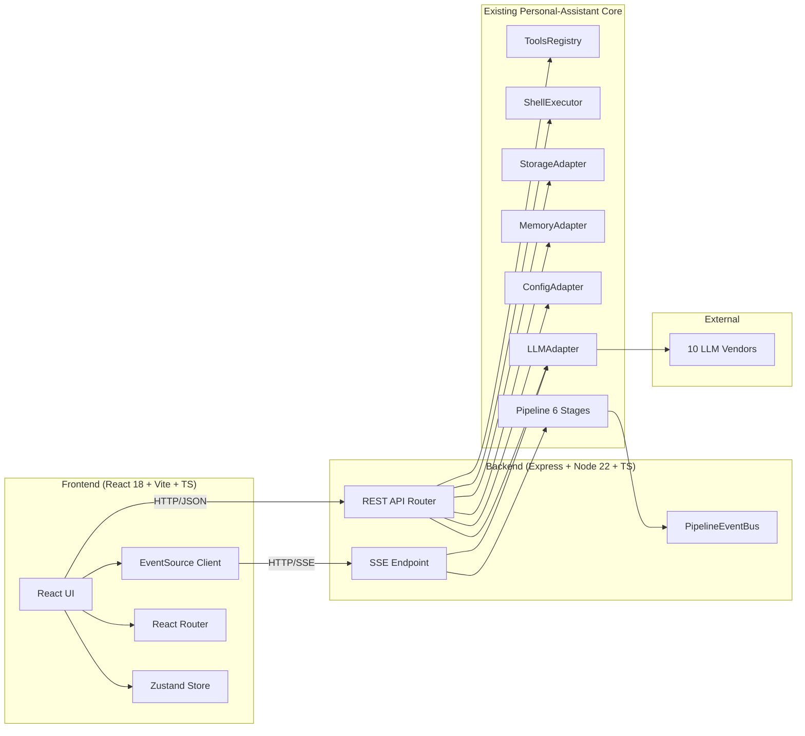

# Personal-Assistant Web — 技术架构文档

## 1. 架构设计



## 2. 技术栈

### 前端

| 类别 | 技术 | 版本 | 理由 |
|------|------|------|------|
| 框架 | React | 18.3 | 成熟、生态最完整 |
| 语言 | TypeScript | 5.8 | strict 模式 + 后端共用类型 |
| 构建 | Vite | 5.x | 启动快、HMR 稳定 |
| 样式 | Tailwind CSS | 3.4 | 原子化、最适合响应式 |
| 状态管理 | Zustand | 4.5 | 轻量、TS 友好、无 boilerplate |
| 路由 | React Router | 6.26 | v6 是 stable 主流 |
| 图标 | lucide-react | latest | 现代、tree-shakable |
| 代码高亮 | react-syntax-highlighter | 15 | 稳定的代码块渲染 |
| Markdown | react-markdown | 9 | + remark-gfm |
| 图谱 | sigma.js + react-force-graph-2d | 兼容版本 | 内存实体可视化 |
| HTTP | 原生 fetch | - | 无需 axios |
| SSE | 原生 EventSource | - | 浏览器原生支持 |
| 打包分析 | rollup-plugin-visualizer | 5 | 监控 bundle 体积 |

### 后端（新增 Express 层）

| 类别 | 技术 | 版本 |
|------|------|------|
| 框架 | Express | 4.21 |
| 中间件 | cors / morgan / express.json | - |
| SSE | 手写 chunked response | - |
| 跨进程 | 与 Personal-Assistant core 同进程 | - |

### 不引入

- ❌ 状态管理库除 Zustand 外（不引入 Redux/Recoil/Jotai）
- ❌ UI 组件库（不引入 shadcn/antd/mui，自己写组件以达设计目标）
- ❌ WebSocket（流式用 SSE 即可）
- ❌ 任何 mock 服务

## 3. 目录结构

```
Personal-Assistant/
├── frontend/                     # 新增 Web 前端
│   ├── index.html
│   ├── package.json
│   ├── tsconfig.json
│   ├── vite.config.ts
│   ├── tailwind.config.js
│   ├── postcss.config.js
│   └── src/
│       ├── main.tsx
│       ├── App.tsx
│       ├── router.tsx
│       ├── components/         # 通用组件（Button/Card/Modal/Spinner 等）
│       ├── pages/              # 路由页面
│       │   ├── Dashboard.tsx
│       │   ├── Chat.tsx
│       │   ├── Agent.tsx
│       │   ├── Tools.tsx
│       │   ├── Memory.tsx
│       │   ├── Config.tsx
│       │   ├── Graph.tsx
│       │   └── Settings.tsx
│       ├── hooks/              # useChat / useAgentStream / useMemory ...
│       ├── stores/             # Zustand stores
│       ├── api/                # API client
│       ├── types/              # 共享 TS 类型
│       ├── styles/             # 全局 CSS
│       └── utils/              # 工具函数
├── server/                       # 新增 Express HTTP/SSE 层
│   ├── index.ts                  # 启动入口
│   ├── app.ts                    # Express app
│   ├── routes/
│   │   ├── chat.routes.ts
│   │   ├── agent.routes.ts
│   │   ├── tools.routes.ts
│   │   ├── memory.routes.ts
│   │   ├── config.routes.ts
│   │   ├── graph.routes.ts
│   │   └── dashboard.routes.ts
│   ├── sse/
│   │   ├── chat.sse.ts           # /api/chat/stream
│   │   └── agent.sse.ts          # /api/agent/run
│   └── shared-types.ts           # 与前端共享类型
├── src/                          # 已有 Core（继续保留并复用）
│   ├── adapters/
│   ├── ports/
│   ├── stages/
│   ├── core/
│   └── domain/
├── package.json                  # 已有，增加 server/frontend workspace
├── .trae/documents/PRD.md
└── .trae/documents/TECHNICAL.md
```

## 4. 路由定义

| 前端路由 | 用途 |
|---------|------|
| `/` | 重定向到 `/dashboard` |
| `/dashboard` | 仪表盘 |
| `/chat` | 聊天主页（默认空状态） |
| `/chat/:sessionId` | 指定会话 |
| `/agent` | Agent 任务页 |
| `/tools` | 工具浏览器 |
| `/memory` | 长期记忆列表 |
| `/config` | 配置管理 |
| `/graph` | 知识图谱 |
| `/settings` | 设置 |

| 后端路由 | 用途 |
|---------|------|
| `GET /api/dashboard` | 仪表盘统计数据 |
| `GET /api/providers` | 10 个 LLM Provider 元数据 |
| `POST /api/config/show` | 当前完整配置 |
| `POST /api/config/set-key` | 写入 API key |
| `POST /api/config/remove-key` | 删除 API key |
| `POST /api/config/set-default` | 设置默认 provider |
| `POST /api/config/test` | 测试 provider 连通性 |
| `GET /api/chat/sessions` | 会话列表 |
| `POST /api/chat/sessions` | 新建会话 |
| `DELETE /api/chat/sessions/:id` | 删除会话 |
| `GET /api/chat/sessions/:id/messages` | 历史消息 |
| `POST /api/chat/stream` | **SSE** 流式对话 |
| `POST /api/agent/run` | **SSE** 流式 Agent 任务 |
| `POST /api/agent/cancel` | 取消正在运行的 Agent |
| `GET /api/tools` | 工具列表 |
| `POST /api/tools/execute` | 调用工具 |
| `GET /api/memory` | 记忆列表（分页 + 搜索） |
| `DELETE /api/memory/:id` | 删除单条 |
| `POST /api/memory/clear` | 清空 |
| `GET /api/graph` | 图谱数据（节点+边） |
| `GET /api/personality` | 4 种人格定义 |
| `POST /api/personality/set` | 切换人格 |
| `GET /api/emotion` | 当前情绪状态 |

## 5. API 类型定义

```typescript
// shared-types.ts

export type ProviderType =
  | 'openai' | 'anthropic' | 'google' | 'deepseek' | 'siliconflow'
  | 'aliyun' | 'zhipu' | 'baidu' | 'ollama' | 'lmstudio';

export interface ProviderMeta {
  id: ProviderType;
  name: string;
  baseUrl: string;
  defaultModel: string;
  requiresKey: boolean;
  protocol: 'openai' | 'anthropic' | 'google' | 'baidu';
}

export interface ChatMessage {
  id: string;
  role: 'user' | 'assistant' | 'system';
  content: string;
  createdAt: string;
  usage?: { promptTokens: number; completionTokens: number; totalTokens: number };
  provider?: ProviderType;
  model?: string;
}

export interface ChatSession {
  id: string;
  title: string;
  createdAt: string;
  updatedAt: string;
  messageCount: number;
}

export type AgentStage = 'initialize' | 'understand' | 'plan' | 'execute' | 'validate' | 'reflect';
export type AgentStageStatus = 'pending' | 'running' | 'done' | 'failed';

export interface AgentStep {
  id: string;
  stage: AgentStage;
  status: AgentStageStatus;
  startedAt?: string;
  finishedAt?: string;
  intent?: string;
  plan?: PlanStep[];
  toolCalls?: ToolCallRecord[];
  error?: string;
}

export interface PlanStep {
  id: string;
  description: string;
  tool?: string;
  status: 'pending' | 'running' | 'done' | 'failed';
  output?: string;
  error?: string;
}

export interface ToolCallRecord {
  toolName: string;
  args: Record<string, unknown>;
  output: string;
  error?: string;
  durationMs: number;
}

export interface MemoryEntry {
  id: string;
  input: string;
  output: string;
  provider: ProviderType;
  model: string;
  tags: string[];
  createdAt: string;
  importance: number;
}

export interface GraphNode {
  id: string;
  label: string;
  type: 'memory' | 'tag' | 'entity';
  weight: number;
}

export interface GraphEdge {
  source: string;
  target: string;
  weight: number;
  type: 'tag' | 'temporal' | 'semantic';
}
```

## 6. SSE 事件协议

### 6.1 聊天流（POST /api/chat/stream）

```
event: chunk
data: {"content":"你","done":false}

event: chunk
data: {"content":"好","done":false}

event: chunk
data: {"content":"","done":true,"usage":{"promptTokens":42,"completionTokens":3,"totalTokens":45}}
```

### 6.2 Agent 任务（POST /api/agent/run）

```
event: stage
data: {"stage":"initialize","status":"running"}

event: stage
data: {"stage":"initialize","status":"done"}

event: stage
data: {"stage":"understand","status":"running"}

event: understand
data: {"intent":"code","filesScanned":39}

event: stage
data: {"stage":"plan","status":"running"}

event: plan
data: {"steps":[{"id":"s1","description":"Read file","tool":"readFile"}]}

event: stage
data: {"stage":"execute","status":"running"}

event: tool-call
data: {"stepId":"s1","toolName":"readFile","args":{"filePath":"/foo.ts"}}

event: tool-result
data: {"stepId":"s1","output":"...","durationMs":42}

event: stage
data: {"stage":"execute","status":"done"}

event: stage
data: {"stage":"validate","status":"running"}

...

event: complete
data: {"success":true,"createdFiles":[],"modifiedFiles":["/foo.ts"]}
```

## 7. 启动与开发

### 7.1 整体启动

```bash
# 安装所有依赖（root + frontend）
npm install
npm --prefix frontend install

# 同时启动后端 + 前端
npm run dev
# = 后端 tsx watch server/ + 前端 vite dev
```

### 7.2 端口

- 前端 dev server: `http://localhost:5173`
- 后端 API: `http://localhost:3000`
- 前端 Vite proxy 把 `/api/*` 转发到 `:3000`

### 7.3 生产构建

```bash
npm --prefix frontend run build       # 输出到 frontend/dist
# 后端 server.ts 静态托管 frontend/dist
PORT=3000 node dist/server/index.js
```

## 8. 复用策略

### 8.1 与 CLI 共享 Core

Web 后端**不重写**任何 Adapter / Stage / Domain，**直接 import** Personal-Assistant `src/`：

```typescript
// server/app.ts
import { ConfigAdapter } from '../src/adapters/config.adapter.js';
import { LLMAdapter } from '../src/adapters/llm.adapter.js';
import { MemoryAdapter } from '../src/adapters/memory.adapter.js';
import { StorageAdapter } from '../src/adapters/storage.adapter.js';
import { ShellExecutor } from '../src/adapters/shell.adapter.js';
import { ToolsRegistry } from '../src/adapters/tools-registry.js';
import { createDefaultStages } from '../src/stages/index.js';
```

保证 Web 和 CLI **共享同一份真实 LLM / 工具 / 记忆实现**，不会出现两边行为不一致。

### 8.2 真实流式响应

SSE 端点直接包装 `LLMAdapter.stream`（已经是 `AsyncGenerator<StreamChunk>`）：

```typescript
// server/sse/chat.sse.ts
async function* chatStream(req: Request) {
  const llm = await getLLM();
  for await (const chunk of llm.stream({
    provider: req.body.provider,
    model: req.body.model,
    messages: req.body.messages,
  })) {
    yield { event: 'chunk', data: JSON.stringify(chunk) };
  }
}
```

### 8.3 真实工具调用

Tools 页面的每个工具调用都走 `ToolsRegistry.execute()` → 真实文件/Shell/Memory/LLM。

## 9. 数据存储

| 数据 | 存储位置 |
|------|---------|
| API key / 配置 | conf 存储（同 CLI） |
| 长期记忆 | MiniSearch 索引 + JSON 文件（同 CLI） |
| 聊天会话 | 新增 `~/.personal-assistant/sessions.json` |
| 知识图谱 | 从 Memory 数据动态构建（不持久化） |
| Agent 任务历史 | 内存（不持久化，会话级） |

## 10. 安全

- API key 仅存后端 conf 文件（0600 权限），不暴露给前端
- 前端通过后端代理调用 LLM（key 在 Authorization 头）
- shell 工具的执行仍然受 SandboxConfig 限制
- 不引入登录系统（本地使用，信任本地用户）

## 11. 性能

- SSE 长连接超时 5 分钟
- Agent Pipeline 单 stage 60 秒超时
- LLM HTTP 超时 120 秒（沿用 LLMAdapter）
- 前端虚拟列表用于 Memory 列表（>100 条时）

## 12. 测试

- 后端 API 端到端：vitest + supertest
- 前端组件：vitest + @testing-library/react
- 真实 LLM 端到端：写一个 integration test，跑通 siliconflow（假 key → 401）
